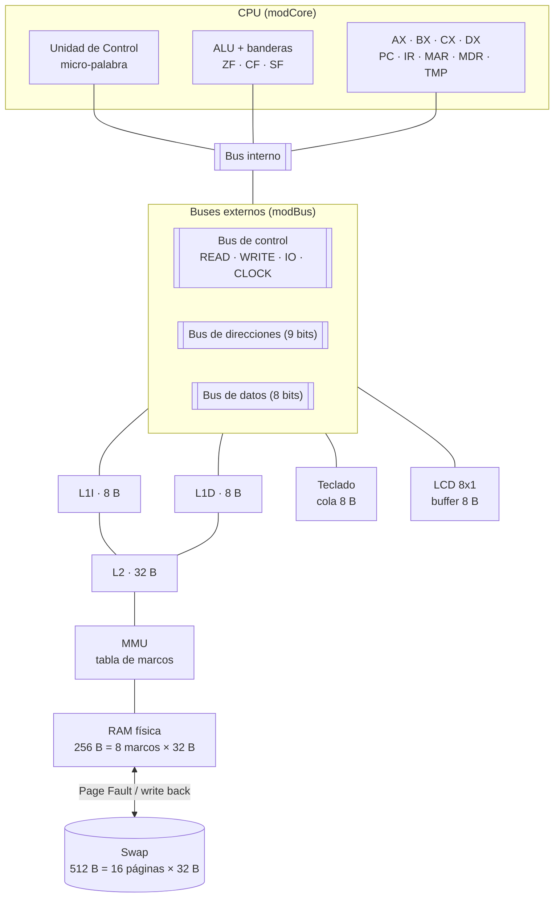
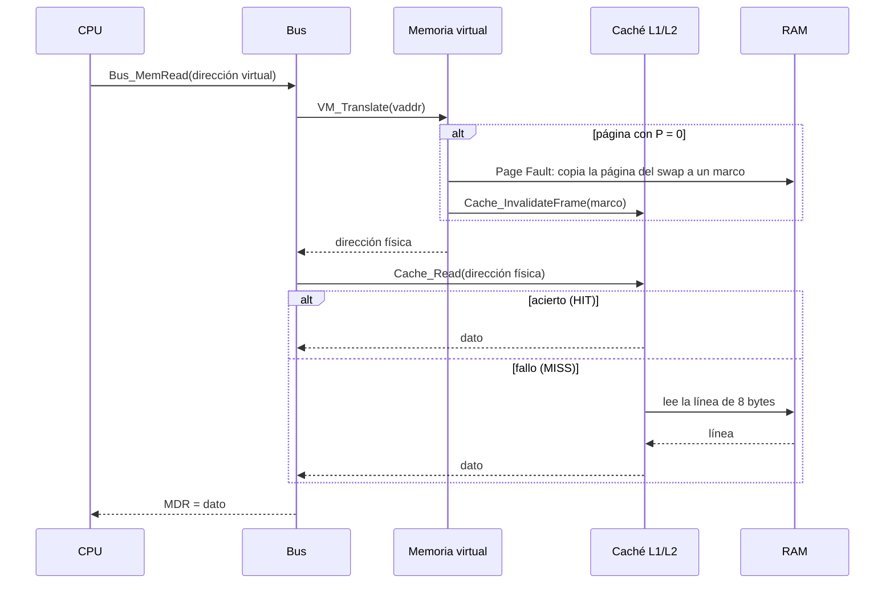
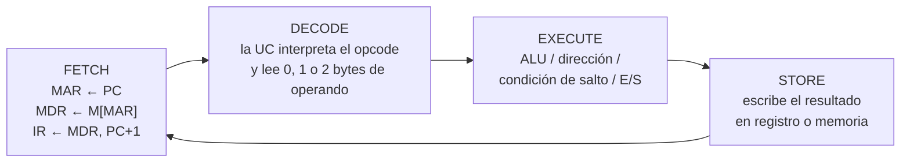
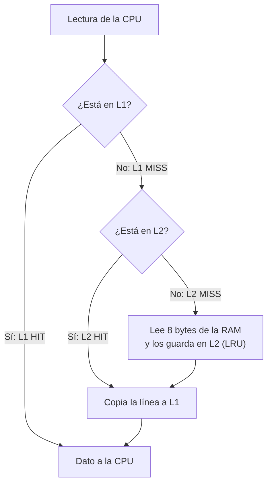
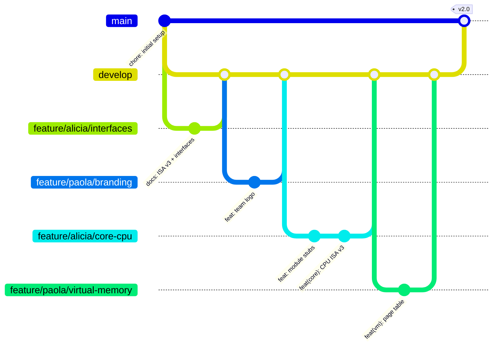

<p align="center">
  
</p>

# 404 Angels — Simulador Avanzado de Arquitectura de Computadoras

> 🇬🇧 English version: [README_EN.md](README_EN.md)

| | |
|---|---|
| **Materia** | Arquitectura de Computadoras (SIS-131) |
| **Docente** | Ing. Paulo César Loayza Carrasco |
| **Equipo** | **404 Angels** — Maria Alicia Belaunde Villagomez · Paola Rosenda Quinteros Pérez |
| **Universidad** | Universidad Católica Boliviana "San Pablo" — Santa Cruz · Semestre 2/2026 |
| **Planilla** | [`404 Angels - CPU Simulator.xlsm`](404%20Angels%20-%20CPU%20Simulator.xlsm) |
| **Tablero Kanban** | [GitHub Projects — 404 Angels](https://github.com/users/aliciabelaunde/projects/10) |

Simulador de una computadora de 8 bits hecho en **Excel VBA**. Extiende la CPU del Parcial 1 con **buses del sistema con buffers tri-estado y micro-palabra de control**, una **jerarquía de caché L1I / L1D / L2**, **memoria virtual paginada con Page Fault** y **periféricos de E/S** (teclado y pantalla LCD 8x1). Todo se ve en vivo: cada pulso de reloj ejecuta una micro-operación y las hojas muestran qué componente usa los buses, qué hay en la caché y qué páginas están en la RAM.


## Contenido

1. [Arquitectura general](#1-arquitectura-general)
2. [CPU y ciclo de instrucción](#2-cpu-y-ciclo-de-instrucción)
3. [Buses, buffers tri-estado y micro-palabra](#3-buses-buffers-tri-estado-y-micro-palabra)
4. [Jerarquía de caché L1I / L1D / L2](#4-jerarquía-de-caché-l1i--l1d--l2)
5. [Memoria virtual y Page Fault](#5-memoria-virtual-y-page-fault)
6. [Periféricos: teclado y LCD 8x1](#6-periféricos-teclado-y-lcd-8x1)
7. [Conjunto de instrucciones (ISA v3)](#7-conjunto-de-instrucciones-isa-v3)
8. [Directorio de programas](#8-directorio-de-programas)
9. [Manual de uso](#9-manual-de-uso)
10. [Metodología: Gitflow y Kanban](#10-metodología-gitflow-y-kanban)
11. [Estructura del repositorio](#11-estructura-del-repositorio)


## 1. Arquitectura general

Computadora **mononúcleo, un solo proceso y un solo hilo**, con arquitectura von Neumann: el programa y los datos comparten la misma memoria.



### Camino de un acceso a memoria



### Módulos y responsables

Cada subsistema es un módulo VBA independiente (archivo `.bas`) con **un solo responsable**. Los módulos se comunican solo a través de las funciones definidas en [`docs/INTERFACES.md`](docs/INTERFACES.md).

| Módulo | Responsable | Contenido | Hoja |
|---|---|---|---|
| `modCore` | Alicia | Registros, ALU, decodificador, unidad de control, botones | CPU, Log |
| `modBus` | Alicia | Buses, buffers tri-estado, micro-palabra, diagrama de buses | CPU |
| `modCache` | Alicia | Caché L1I, L1D, L2, contadores y diagrama | Cache |
| `modVirtualMemory` | Paola | RAM física, swap, tabla de marcos, Page Fault, FIFO | Memory |
| `modIO` | Paola | Cola de teclado y pantalla LCD 8x1 | IO |
| `modAssembler` | Paola | Catálogo, editor, ensamblador y cargador | Programs |
| `modConfig` | Ambas | Constantes compartidas | — |
| `modBuild` | Ambas | Importa los `.bas` a la planilla | — |


## 2. CPU y ciclo de instrucción

| Registro | Bits | Función |
|---|---|---|
| **PC** | 9 | Dirección de la siguiente instrucción (`000h–1FFh`) |
| **IR** | 8 + operandos | Instrucción actual |
| **MAR** | 9 | Dirección que se lee o escribe |
| **MDR** | 8 | Dato que entra o sale de la memoria |
| **AX** | 8 | Acumulador |
| **BX** | 8 | Base / puntero (`[BX]` = `100h + BX`) |
| **CX** | 8 | Contador de bucles |
| **DX** | 8 | Datos y periféricos |
| **TMP** | 8 | Registro temporal de la unidad de control |
| **ZF · CF · SF** | 1 | Cero · Acarreo/préstamo · Signo |

**Un pulso de reloj = una micro-operación.** Cada instrucción pasa por 4 fases:



| Tipo de instrucción | FETCH | DECODE | EXECUTE | STORE | Pulsos |
|---|---|---|---|---|---|
| 1 byte (`ADD AX, BX`, `INC CX`, `IN`, `OUT`) | 3 | 1 | 1 | 1 | **6** |
| 2 bytes (`MOV AX, 05h`) | 3 | 4 | 1 | 1 | **9** |
| 3 bytes, salto (`JNZ 00Dh`) | 3 | 7 | 1 | 1 | **12** |
| 3 bytes, `LOAD` / `STORE [addr9]` | 3 | 7 | 2 | 1 | **13** |
| 1 byte, `LOAD` / `STORE [BX]` | 3 | 1 | 2 | 1 | **7** |

**Banderas (como x86):** `ADD` pone CF = 1 si hay acarreo; `SUB` y `CMP` ponen CF = 1 si hay préstamo; `AND`, `OR` y `XOR` ponen CF = 0; `INC` y `DEC` no cambian CF; `NOT`, `IN` y `OUT` no cambian ninguna bandera. ZF = 1 si el resultado es 0 y SF es el bit 7 del resultado.


## 3. Buses, buffers tri-estado y micro-palabra

### Buses

| Bus | Ancho | Conecta | Quién lo maneja |
|---|---|---|---|
| **Interno** | 8/9 bits | PC, IR, MAR, MDR, AX, BX, CX, DX, TMP, ALU | Un registro con `En_` = 1 |
| **Externo de datos** | 8 bits, bidireccional | MDR ↔ caché/memoria, teclado, LCD | MEM (lectura), MDR (escritura), KBD (`IN`), registro (`OUT`) |
| **De direcciones** | 9 bits | MAR → memoria | MAR |
| **De control** | 4 líneas | UC → memoria y E/S | READ, WRITE, IO, CLOCK |

### Buffers tri-estado

Cada componente conectado a un bus tiene un buffer de **3 estados**: `1`, `0` o **alta impedancia (High-Z)**.

> **Regla física:** en cada micro-paso **solo un componente** tiene `Enable = 1` en cada bus. Todos los demás quedan en **High-Z** (desconectados). Los componentes con `Load = 1` guardan el valor que está en el bus.

El simulador **verifica esta regla en cada pulso** y la muestra en la fila *Bus rule* de la hoja CPU. Si hubiera dos emisores en el mismo bus, se marcaría en rojo como conflicto.

### Micro-palabra de control (24 bits)

| Bits 0–7 | Bits 8–15 | Bits 16–23 |
|---|---|---|
| `En_PC` `Ld_PC` `PC_Inc` `Ld_MAR` `En_MDR` `Ld_MDR` `En_IR` `Ld_IR` | `En_AX` `Ld_AX` `En_BX` `Ld_BX` `En_CX` `Ld_CX` `En_DX` `Ld_DX` | `En_TMP` `Ld_TMP` `ALU` `Mem_R` `Mem_W` `IO` `En_KBD` `Ld_LCD` |

- `En_X` (Enable): X **pone** su valor en el bus.
- `Ld_X` (Load): X **guarda** el valor del bus en el flanco de reloj.

### Micro-palabras por fase

| Micro-operación | Señales activas | Bus usado |
|---|---|---|
| `MAR ← PC` | `En_PC Ld_MAR` | interno |
| `MDR ← M[MAR]` | `Mem_R Ld_MDR` | direcciones + datos externo |
| `IR ← MDR ; PC ← PC+1` | `En_MDR Ld_IR PC_Inc` | interno |
| `TMP ← AX + BX` | `En_BX ALU_ADD Ld_TMP` | interno (AX entra directo a la ALU) |
| `AX ← TMP` | `En_TMP Ld_AX` | interno |
| `MAR ← 100h + BX` | `En_BX Ld_MAR` | interno |
| `MDR ← AX` | `En_AX Ld_MDR` | interno |
| `M[MAR] ← MDR` | `En_MDR Mem_W` | direcciones + datos externo |
| `PC ← IR(op)` (salto tomado) | `En_IR Ld_PC` | interno |
| `TMP ← KBD` (`IN`) | `IO_R En_KBD Ld_TMP` | datos externo |
| `LCD ← CX` (`OUT`) | `IO_W En_CX Ld_LCD` | datos externo |

### Visualización (hoja CPU)

- **Tabla de buses:** para cada componente muestra `EN = 1` (verde), `LD = 1` (azul) o `Z` (High-Z, gris), el valor que viaja por cada bus y los 24 bits de la micro-palabra.
- **Diagrama animado:** cajas para los registros, la memoria, el teclado y el LCD; cables que se iluminan en naranja cuando llevan un dato; triángulos de tri-estado en verde (Enable) o gris (High-Z); y luces READ, WRITE, IO y CLOCK del bus de control.


## 4. Jerarquía de caché L1I / L1D / L2

| Nivel | Tamaño | Organización | Contenido |
|---|---|---|---|
| **L1I** | 8 B | 1 línea de 8 bytes | Solo instrucciones (fetch y operandos) |
| **L1D** | 8 B | 1 línea de 8 bytes | Solo datos (`LOAD` / `STORE`) |
| **L2** | 32 B | 4 líneas de 8 bytes, totalmente asociativa | Unificada (instrucciones y datos) |

- **Etiqueta (tag):** número de línea física = `dirección \ 8`.
- **Reemplazo en L2:** **LRU** (sale la línea usada hace más tiempo).
- **Escritura:** **write-through, no write-allocate**. Toda escritura va a la RAM, así la RAM siempre está actualizada.
- **Zona no cacheable:** `E0h–EFh` (cola de teclado y buffer LCD), que siempre se lee directo de la RAM.
- **Coherencia con la memoria virtual:** cuando un marco se reemplaza, la memoria virtual llama a `Cache_InvalidateFrame` y la caché descarta las líneas de ese marco.



**Hoja Cache:** contenido de cada línea (válida, etiqueta, 8 bytes y edad LRU), el byte leído resaltado en amarillo, contadores de aciertos y fallos con **tasa de aciertos (hit rate)** por nivel, y un diagrama animado CPU → L1 → L2 → RAM con el camino del acceso en verde (HIT) o rojo (MISS).

Ejemplo con el programa de multiplicación (7 × 3): **L1I 78.1 %**, **L1D 66.7 %**, **L2 50.0 %**.


## 5. Memoria virtual y Page Fault

| | Tamaño | División |
|---|---|---|
| **Memoria virtual** | 512 B | 16 páginas de 32 B (página 0–15) |
| **RAM física** | 256 B | 8 marcos de 32 B (marco 0–7) |
| **Swap (disco)** | 512 B | copia de las 16 páginas |

**Traducción:** dirección virtual de 9 bits = VPN (4 bits) + desplazamiento (5 bits).

```
VPN          = dirección_virtual \ 32
desplazamiento = dirección_virtual mod 32
dirección_física = PFN × 32 + desplazamiento
```

Ejemplo: dirección virtual **082h** = 130 → VPN = 4, desplazamiento = 2. Si la página 4 está en el marco 1 → dirección física = 1 × 32 + 2 = **22h**.

**Tabla de marcos:** 16 entradas con **VPN**, bit **Presente (P)**, **PFN** (marco), bit **Dirty** y bit de **Referencia**.

**Page Fault** (acceso a una página con P = 0):
1. Se marca en rojo el Page Fault.
2. Se busca un marco libre. Si la RAM está llena, **FIFO** elige la página más antigua de los marcos 0–6.
3. Si la víctima tiene **Dirty = 1**, se guarda en el swap (*write back*).
4. Se copian los 32 bytes de la página del swap al marco y se actualiza la tabla (P = 1).
5. La instrucción continúa.

La **página 15** (teclado y LCD) está fija en el **marco 7** y nunca la reemplaza FIFO.

**Hoja Memory:** panel de traducción de la última dirección (VPN, desplazamiento, PFN y dirección física), contadores de accesos y Page Faults, la tabla de marcos, los 8 marcos de la RAM y el swap con colores: **verde** = página presente (P = 1), **gris** = en disco (P = 0), **rojo** = Page Fault y **naranja** = víctima de FIFO. Un diagrama animado CPU → MMU → marcos muestra las flechas **PAGE IN** (del swap a la RAM) y **WRITE BACK** (de la RAM al swap).


## 6. Periféricos: teclado y LCD 8x1

Los periféricos están **mapeados en memoria**, dentro de la página 15 (marco 7). La zona `E0h–EFh` **no pasa por la caché**.

| Virtual | Física | Contenido |
|---|---|---|
| `1E0h–1E7h` | `E0h–E7h` | Cola del teclado: 8 bytes, **cola circular (FIFO)** |
| `1E8h–1EFh` | `E8h–EFh` | Buffer de video de la LCD (8 caracteres ASCII) |

### Cola circular del teclado

Los 8 caracteres se guardan en la RAM (`E0h–E7h`) y tres punteros controlan la cola: **HEAD** (siguiente carácter a leer), **TAIL** (siguiente posición libre) y **COUNT** (caracteres en espera).

| Operación | Condición | Acción |
|---|---|---|
| El teclado escribe un carácter | `COUNT < 8` | `RAM[E0h + TAIL] = carácter`, `TAIL = (TAIL + 1) mod 8`, `COUNT + 1` |
| `IN reg, [KBD]` | `COUNT > 0` | `reg = RAM[E0h + HEAD]`, `HEAD = (HEAD + 1) mod 8`, `COUNT − 1` |
| `IN reg, [KBD]` | `COUNT = 0` | `reg = 0` (cola vacía) |
| El teclado escribe un carácter | `COUNT = 8` | Se descarta (desbordamiento) |

### LCD 8x1

`OUT [LCD], reg` escribe el carácter en la posición del cursor (`E8h + cursor`) y avanza el cursor. Cuando la línea se llena, el texto **se desplaza una posición a la izquierda**. El carácter `08h` (retroceso) mueve el cursor hacia atrás y escribe un espacio.

### Instrucciones de E/S

- `IN reg, [KBD]` (`D0–D3`): el teclado pone el carácter en el bus de datos (`IO_R En_KBD`) y se guarda en el registro.
- `OUT [LCD], reg` (`D4–D7`): el registro pone el carácter en el bus (`IO_W En_reg`) y la LCD lo guarda (`Ld_LCD`).
- Ninguna de las dos modifica las banderas.

**Hoja IO:** celda para escribir texto con el botón **SEND**, la cola con sus punteros HEAD, TAIL y COUNT, la pantalla LCD de 8 caracteres y las señales del bus en cada operación.

---

## 7. Conjunto de instrucciones (ISA v3)

Códigos de registro: `AX = 00`, `BX = 01`, `CX = 10`, `DX = 11`. Fuente oficial: [`docs/ISA.md`](docs/ISA.md).

| Opcode | Instrucción | Bytes | Descripción |
|---|---|---|---|
| `00` | `NOP` | 1 | Sin operación |
| `1X` | `MOV r1, r2` | 1 | r1 ← r2 (nibble bajo = `dd ss`) |
| `2X` | `ADD r1, r2` | 1 | r1 ← r1 + r2 |
| `3X` | `SUB r1, r2` | 1 | r1 ← r1 − r2 |
| `4X` | `CMP r1, r2` | 1 | r1 − r2, solo banderas |
| `5X` | `AND r1, r2` | 1 | r1 ← r1 AND r2 |
| `6X` | `OR r1, r2` | 1 | r1 ← r1 OR r2 |
| `7X` | `XOR r1, r2` | 1 | r1 ← r1 XOR r2 |
| `80–83` | `MOV r, imm8` | 2 | r ← imm8 |
| `84–87` | `ADD r, imm8` | 2 | r ← r + imm8 |
| `88–8B` | `SUB r, imm8` | 2 | r ← r − imm8 |
| `8C–8F` | `CMP r, imm8` | 2 | r − imm8, solo banderas |
| `90–93` | `AND r, imm8` | 2 | r ← r AND imm8 |
| `94–97` | `OR r, imm8` | 2 | r ← r OR imm8 |
| `98–9B` | `XOR r, imm8` | 2 | r ← r XOR imm8 |
| `A0–A3` | `LOAD r, [addr9]` | 3 | r ← M[addr9] (dirección: byte bajo, byte alto) |
| `A4–A7` | `STORE [addr9], r` | 3 | M[addr9] ← r |
| `A8–AB` | `LOAD r, [BX]` | 1 | r ← M[100h + BX] |
| `AC–AF` | `STORE [BX], r` | 1 | M[100h + BX] ← r |
| `B0–B3` | `INC r` | 1 | r ← r + 1 (CF sin cambio) |
| `B4–B7` | `DEC r` | 1 | r ← r − 1 (CF sin cambio) |
| `B8–BB` | `NOT r` | 1 | r ← NOT r (banderas sin cambio) |
| `C0` | `JMP addr9` | 3 | Salto incondicional |
| `C1` / `C2` | `JZ` / `JNZ addr9` | 3 | Salta si ZF = 1 / ZF = 0 |
| `C3` / `C4` | `JC` / `JNC addr9` | 3 | Salta si CF = 1 / CF = 0 |
| `C5` / `C6` | `JS` / `JNS addr9` | 3 | Salta si SF = 1 / SF = 0 |
| `D0–D3` | `IN r, [KBD]` | 1 | r ← teclado (banderas sin cambio) |
| `D4–D7` | `OUT [LCD], r` | 1 | LCD ← r (banderas sin cambio) |
| `FF` | `HLT` | 1 | Detiene el reloj |

**Ejemplo de codificación:** `21h` = `0010 00 01` → operación 2 (ADD), destino 00 (AX), fuente 01 (BX) → `ADD AX, BX`.

### Mapa de memoria virtual

| Rango | Uso |
|---|---|
| `000h–0FFh` | Código (páginas 0–7) |
| `100h–1DFh` | Datos (páginas 8–14) |
| `1E0h–1E7h` | Cola del teclado (página 15) |
| `1E8h–1EFh` | Buffer de la LCD (página 15) |


## 8. Directorio de programas

Los programas **no están dentro del código VBA**: se escriben en las **celdas de la hoja Programs**. El catálogo ocupa las columnas **K, L y M** y la carpeta [`programs/`](programs/) guarda una copia de cada uno.

| # | Programa | Qué demuestra | Resultado |
|---|---|---|---|
| 1 | [`01_loops_factorial.asm`](programs/01_loops_factorial.asm) | Bucles anidados con AX, BX, CX y DX | `5! = 120 = 78h` en `101h` |
| 2 | [`02_keyboard_echo.asm`](programs/02_keyboard_echo.asm) | `IN` / `OUT`: lo escrito en el teclado aparece en la LCD | 8 caracteres en la LCD |
| 3 | [`03_page_faults.asm`](programs/03_page_faults.asm) | Accesos dispersos a las páginas 8–14: Page Faults, FIFO, write back y fallos de caché | `SUM = 23h` en `1DFh` |

**Ensamblador de dos pasadas:** acepta etiquetas (`BUCLE:`), comentarios (`;`), números decimales o hexadecimales (`0Ch`, `1E0h`) y las directivas `ORG` y `DB`. Las líneas con error se marcan en rojo con su descripción.

**Sintaxis:**
```
ETIQUETA:  MNEMONICO operando1, operando2   ; comentario
```

---

## 9. Manual de uso

### Abrir la planilla
1. Abrir `404 Angels - CPU Simulator.xlsm` y presionar **Habilitar contenido** (macros).
2. Si Excel bloquea las macros: *Archivo → Opciones → Centro de confianza → Ubicaciones de confianza → Agregar* la carpeta del proyecto.

### Botones de la hoja CPU

| Botón | Qué hace |
|---|---|
| **STEP (micro-op)** | Avanza **un pulso de reloj** (una micro-operación) |
| **STEP INSTR** | Ejecuta una **instrucción completa**, de FETCH a STORE |
| **RUN** | Ejecuta hasta `HLT`, con el retardo en ms de la celda **Run delay** |
| **PAUSE** | Detiene RUN sin perder el estado |
| **RESET** | Registros, banderas y PC en 0. La memoria se conserva |

### Ejecutar un programa
1. En la hoja **Programs**, presionar **OPEN 1**, **OPEN 2** u **OPEN 3**: el programa se copia al editor (columna B), donde se puede modificar. También se puede escribir uno nuevo.
2. Presionar **ASSEMBLE** para revisar la sintaxis y ver las direcciones y bytes de cada línea, y **LOAD PROGRAM** para cargarlo en la memoria virtual.
3. En la hoja **CPU**, usar **STEP**, **STEP INSTR** o **RUN**.
4. Observar:
   - **CPU:** registros, fases, micro-palabra y diagrama de buses.
   - **Cache:** aciertos y fallos de L1I, L1D y L2.
   - **Memory:** tabla de marcos y Page Faults.
   - **IO:** teclado y pantalla LCD.
   - **Log:** historial de todas las micro-operaciones.

### Para desarrolladores: armar la planilla desde `src/`
1. Excel → *Centro de confianza → Configuración de macros* → marcar **Confiar en el acceso al modelo de objetos de proyectos de VBA**.
2. Crear un libro habilitado para macros en `local/dev.xlsm` e importar `src/modBuild.bas` (Alt + F11 → *Archivo → Importar archivo*).
3. Ejecutar **`Build_ImportModules`** (importa todos los módulos) y **`Build_SetupAll`** (crea las hojas y los botones).


## 10. Metodología: Gitflow y Kanban

### Ramas



| Rama | Uso |
|---|---|
| `main` | Solo versiones entregadas (tag `v2.0`). Protegida |
| `develop` | Integración. Protegida, solo entra por Pull Request |
| `feature/<alumna>/<módulo>` | Una rama por tarea, por ejemplo `feature/alicia/cache` o `feature/paola/virtual-memory` |
| `release/v2.0` | Armado de la planilla final y pruebas |

- **Pull Requests** hacia `develop`, revisados y aprobados por la otra integrante.
- **Commits semánticos** en inglés: `feat(cache): ...`, `fix(bus): ...`, `docs: ...`.
- **Sin conflictos de merge:** cada archivo tiene una sola responsable y la planilla `.xlsm` se arma solo al final desde los `.bas`.

### Kanban

Tablero en GitHub Projects con las columnas **Backlog → Ready → In progress → In review → Done**. Cada tarjeta sigue el formato del curso: *Title, Requester, Action, Reason, Benefit, Asignee, Creation Date, Due date, Repository*.

---

## Pruebas realizadas

| Prueba | Resultado esperado | Resultado |
|---|---|---|
| Programa de multiplicación 7 × 3 | AX = 15h, 16 instrucciones, 147 pulsos | ✅ |
| Page Faults con la demo | 2 (página 0 de código y página 4 de datos) | ✅ |
| Caché con la demo | L1I 78.1 %, L1D 66.7 %, L2 50.0 % | ✅ |
| Regla de un solo emisor por bus | "OK" en cada pulso | ✅ |
| Programa que toca 8 páginas (RAM llena) | FIFO saca páginas, write back de las modificadas y el dato vuelve correcto | ✅ |
| Reemplazo LRU en L2 con 5 líneas distintas | Sale la línea menos usada | ✅ |
| Lectura de la zona E0h–EFh | No pasa por la caché | ✅ |
| Programa 1: factorial | `5! = 120 = 78h` | ✅ |
| Programa 2: eco del teclado | "HOLA1234" aparece en la LCD | ✅ |
| Programa 3: accesos dispersos | `SUM = 23h` con Page Faults y FIFO | ✅ |

---

## 11. Estructura del repositorio

```
404-angels-cpu-simulator/
├── 404 Angels - CPU Simulator.xlsm   # planilla final (solo en releases)
├── README.md                         # documentación en español
├── README_EN.md                      # documentación en inglés
├── src/                              # módulos VBA (.bas), uno por subsistema
│   ├── modCore.bas  modBus.bas  modCache.bas
│   ├── modVirtualMemory.bas  modIO.bas  modAssembler.bas
│   └── modConfig.bas  modBuild.bas
├── docs/
│   ├── ISA.md                        # conjunto de instrucciones (fuente oficial)
│   ├── INTERFACES.md                 # contrato entre módulos
│   └── assets/logo.png
└── local/                            # copia de trabajo personal (no se sube)
```
