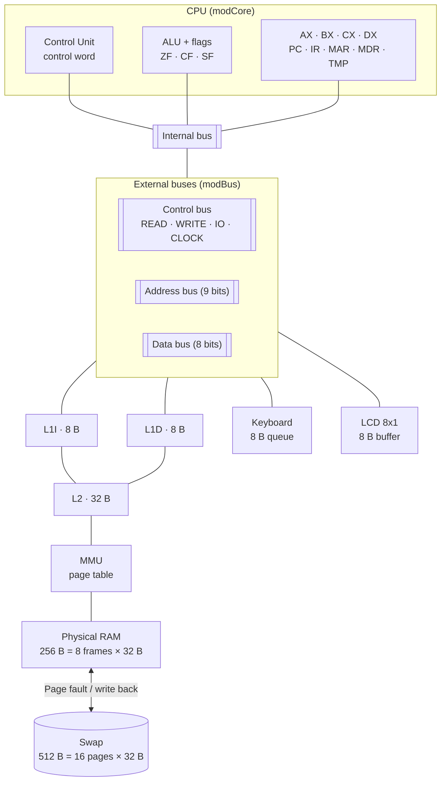
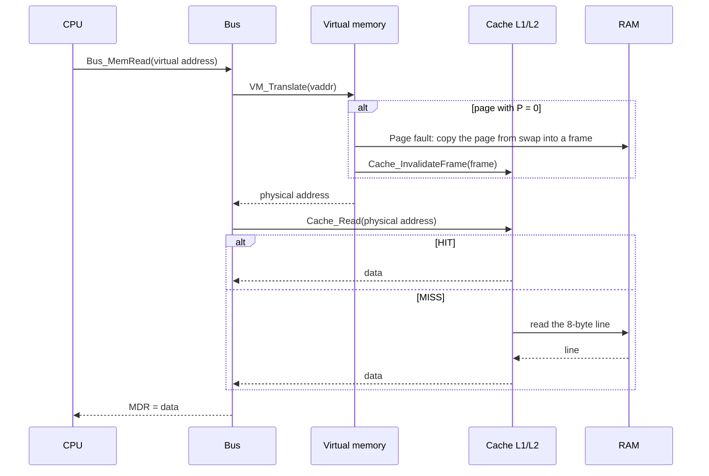
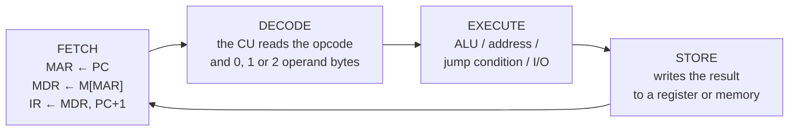
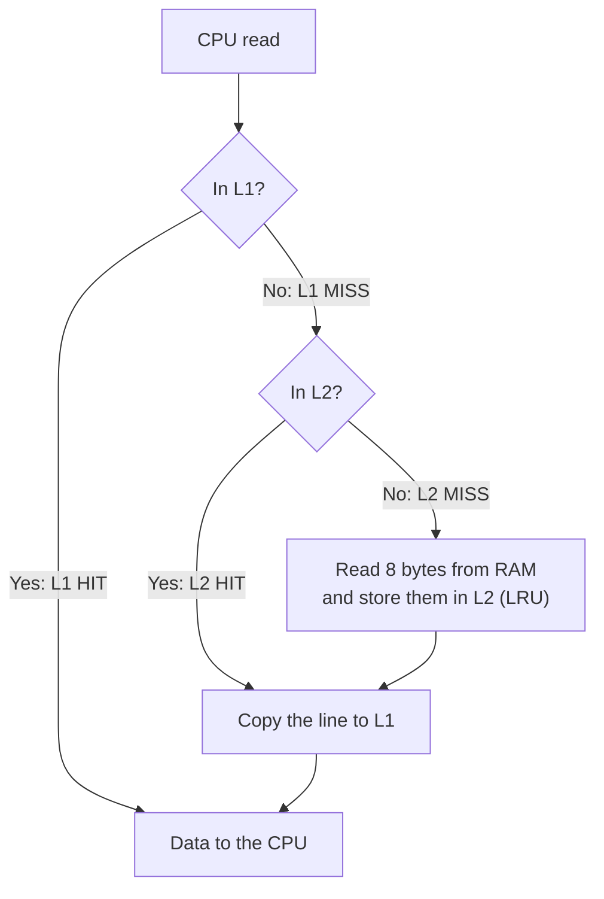
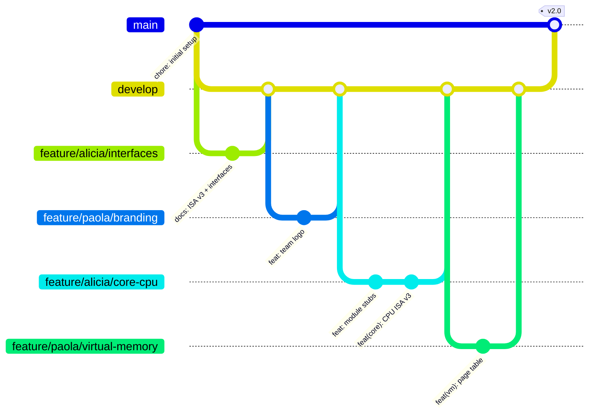

<p align="center">
  
</p>

# 404 Angels - Advanced Computer Architecture Simulator

> 🇪🇸 Versión en español: [README.md](README.md)

| | |
|---|---|
| **Course** | Computer Architecture (SIS-131) |
| **Instructor** | Ing. Paulo César Loayza Carrasco |
| **Team** | **404 Angels**: Maria Alicia Belaunde Villagomez · Paola Rosenda Quinteros Pérez |
| **University** | Universidad Católica Boliviana "San Pablo", Santa Cruz · Semester 2/2026 |
| **Spreadsheet** | [`404 Angels - CPU Simulator.xlsm`](404%20Angels%20-%20CPU%20Simulator.xlsm) |
| **Kanban board** | [GitHub Projects: 404 Angels](https://github.com/users/aliciabelaunde/projects/10) |

This is an 8-bit computer simulator made in Excel VBA. It takes the CPU from Parcial 1 and adds system buses with tri-state buffers and a control word, an L1I / L1D / L2 cache, paged virtual memory with page faults, and two I/O devices: a keyboard and an 8x1 LCD. You can watch everything while it runs. Each clock pulse is one micro-operation, and the sheets show which component is using the buses, what is in the cache and which pages are in RAM.


## Contents

1. [System architecture](#1-system-architecture)
2. [CPU and instruction cycle](#2-cpu-and-instruction-cycle)
3. [Buses, tri-state buffers and control word](#3-buses-tri-state-buffers-and-control-word)
4. [L1I / L1D / L2 cache hierarchy](#4-l1i--l1d--l2-cache-hierarchy)
5. [Virtual memory and page faults](#5-virtual-memory-and-page-faults)
6. [I/O devices: keyboard and 8x1 LCD](#6-io-devices-keyboard-and-8x1-lcd)
7. [Instruction set (ISA v3)](#7-instruction-set-isa-v3)
8. [Program directory](#8-program-directory)
9. [User manual](#9-user-manual)
10. [Methodology: Gitflow and Kanban](#10-methodology-gitflow-and-kanban)
11. [Repository structure](#11-repository-structure)


## 1. System architecture

The computer has one core and runs one process with one thread. It follows the von Neumann architecture, so the program and its data share the same memory.



### Path of a memory access



### Modules and owners

Each subsystem is its own VBA module (a `.bas` file) and has one owner. Modules only talk to each other through the functions listed in [`docs/INTERFACES.md`](docs/INTERFACES.md).

| Module | Owner | Contents | Sheet |
|---|---|---|---|
| `modCore` | Alicia | Registers, ALU, decoder, control unit, buttons | CPU, Log |
| `modBus` | Alicia | Buses, tri-state buffers, control word, bus diagram | CPU |
| `modCache` | Alicia | L1I, L1D and L2 caches, counters and diagram | Cache |
| `modVirtualMemory` | Paola | Physical RAM, swap, page table, page fault, FIFO | Memory |
| `modIO` | Paola | Keyboard queue and 8x1 LCD | IO |
| `modAssembler` | Paola | Catalog, editor, assembler and loader | Programs |
| `modConfig` | Both | Shared constants | - |
| `modBuild` | Both | Imports the `.bas` files into the spreadsheet | - |


## 2. CPU and instruction cycle

| Register | Bits | Purpose |
|---|---|---|
| **PC** | 9 | Address of the next instruction (`000h–1FFh`) |
| **IR** | 8 + operands | Current instruction |
| **MAR** | 9 | Address being read or written |
| **MDR** | 8 | Data going into or out of memory |
| **AX** | 8 | Accumulator |
| **BX** | 8 | Base / pointer (`[BX]` = `100h + BX`) |
| **CX** | 8 | Loop counter |
| **DX** | 8 | Data and I/O |
| **TMP** | 8 | Temporary register of the control unit |
| **ZF · CF · SF** | 1 | Zero · Carry/borrow · Sign |

One clock pulse runs one micro-operation. Every instruction goes through 4 phases:



| Instruction type | FETCH | DECODE | EXECUTE | STORE | Pulses |
|---|---|---|---|---|---|
| 1 byte (`ADD AX, BX`, `INC CX`, `IN`, `OUT`) | 3 | 1 | 1 | 1 | **6** |
| 2 bytes (`MOV AX, 05h`) | 3 | 4 | 1 | 1 | **9** |
| 3 bytes, jump (`JNZ 00Dh`) | 3 | 7 | 1 | 1 | **12** |
| 3 bytes, `LOAD` / `STORE [addr9]` | 3 | 7 | 2 | 1 | **13** |
| 1 byte, `LOAD` / `STORE [BX]` | 3 | 1 | 2 | 1 | **7** |

Flags work as in x86. `ADD` sets CF = 1 when there is a carry, and `SUB` and `CMP` set it when there is a borrow. `AND`, `OR` and `XOR` clear CF, while `INC` and `DEC` leave it as it was. `NOT`, `IN` and `OUT` don't change any flag. ZF = 1 when the result is 0, and SF is bit 7 of the result.


## 3. Buses, tri-state buffers and control word

### Buses

| Bus | Width | Connects | Driven by |
|---|---|---|---|
| **Internal** | 8/9 bits | PC, IR, MAR, MDR, AX, BX, CX, DX, TMP, ALU | One register with `En_` = 1 |
| **External data** | 8 bits, bidirectional | MDR ↔ cache/memory, keyboard, LCD | MEM (read), MDR (write), KBD (`IN`), register (`OUT`) |
| **Address** | 9 bits | MAR → memory | MAR |
| **Control** | 4 lines | CU → memory and I/O | READ, WRITE, IO, CLOCK |

### Tri-state buffers

Every component connected to a bus has a 3-state buffer: `1`, `0` or high impedance (High-Z).

> Physical rule: in every micro-step only one component can have `Enable = 1` on each bus. All the others stay in High-Z, which means they are disconnected. Components with `Load = 1` save the value that is on the bus.

The simulator checks this rule on every pulse and shows the result in the *Bus rule* row of the CPU sheet. If two components drove the same bus, that row would turn red as a conflict.

### Control word (24 bits)

| Bits 0–7 | Bits 8–15 | Bits 16–23 |
|---|---|---|
| `En_PC` `Ld_PC` `PC_Inc` `Ld_MAR` `En_MDR` `Ld_MDR` `En_IR` `Ld_IR` | `En_AX` `Ld_AX` `En_BX` `Ld_BX` `En_CX` `Ld_CX` `En_DX` `Ld_DX` | `En_TMP` `Ld_TMP` `ALU` `Mem_R` `Mem_W` `IO` `En_KBD` `Ld_LCD` |

- `En_X` (Enable): X puts its value on the bus.
- `Ld_X` (Load): X saves the value on the bus at the clock edge.

### Control words by phase

| Micro-operation | Active signals | Bus used |
|---|---|---|
| `MAR ← PC` | `En_PC Ld_MAR` | internal |
| `MDR ← M[MAR]` | `Mem_R Ld_MDR` | address + external data |
| `IR ← MDR ; PC ← PC+1` | `En_MDR Ld_IR PC_Inc` | internal |
| `TMP ← AX + BX` | `En_BX ALU_ADD Ld_TMP` | internal (AX goes straight into the ALU) |
| `AX ← TMP` | `En_TMP Ld_AX` | internal |
| `MAR ← 100h + BX` | `En_BX Ld_MAR` | internal |
| `MDR ← AX` | `En_AX Ld_MDR` | internal |
| `M[MAR] ← MDR` | `En_MDR Mem_W` | address + external data |
| `PC ← IR(op)` (jump taken) | `En_IR Ld_PC` | internal |
| `TMP ← KBD` (`IN`) | `IO_R En_KBD Ld_TMP` | external data |
| `LCD ← CX` (`OUT`) | `IO_W En_CX Ld_LCD` | external data |

### What the CPU sheet shows

- Bus table: for every component it shows `EN = 1` (green), `LD = 1` (blue) or `Z` (High-Z, gray), the value travelling on each bus and the 24 bits of the control word.
- Animated diagram: boxes for the registers, the memory, the keyboard and the LCD; wires that light up in orange when they carry data; tri-state triangles in green (Enable) or gray (High-Z); and READ, WRITE, IO and CLOCK lamps for the control bus.


## 4. L1I / L1D / L2 cache hierarchy

| Level | Size | Organization | Contents |
|---|---|---|---|
| **L1I** | 8 B | 1 line of 8 bytes | Instructions only (fetch and operands) |
| **L1D** | 8 B | 1 line of 8 bytes | Data only (`LOAD` / `STORE`) |
| **L2** | 32 B | 4 lines of 8 bytes, fully associative | Unified (instructions and data) |

- Tag: physical line number = `address \ 8`.
- L2 replacement: LRU, so the line that was used longest ago leaves.
- Writes: write-through with no write-allocate. Every write goes to RAM, so RAM is always up to date.
- Non-cacheable range: `E0h–EFh` (keyboard queue and LCD buffer) is always read straight from RAM.
- Coherence with virtual memory: when a frame is replaced, the virtual memory calls `Cache_InvalidateFrame` and the cache drops the lines of that frame.



The Cache sheet shows every line (valid bit, tag, 8 bytes and LRU age) with the byte just read in yellow. It also has hit and miss counters with the hit rate of each level, and an animated CPU → L1 → L2 → RAM diagram where the path of each access turns green on a HIT and red on a MISS.

With the multiplication program (7 × 3) the hit rates are L1I 78.1 %, L1D 66.7 % and L2 50.0 %.


## 5. Virtual memory and page faults

| | Size | Division |
|---|---|---|
| **Virtual memory** | 512 B | 16 pages of 32 B (pages 0–15) |
| **Physical RAM** | 256 B | 8 frames of 32 B (frames 0–7) |
| **Swap (disk)** | 512 B | a copy of the 16 pages |

A virtual address has 9 bits: the VPN (4 bits) and the offset (5 bits).

```
VPN              = virtual_address \ 32
offset           = virtual_address mod 32
physical_address = PFN × 32 + offset
```

For example, virtual address 082h is 130, so VPN = 4 and offset = 2. If page 4 is in frame 1, the physical address is 1 × 32 + 2 = 22h.

The page table has 16 entries. Each one has the VPN, the Present bit (P), the PFN (frame), the Dirty bit and the Reference bit.

A page fault happens when the CPU uses a page with P = 0:
1. The page fault is shown in red.
2. A free frame is chosen. If RAM is full, FIFO picks the oldest page in frames 0–6.
3. If that page has Dirty = 1, it is saved to swap first (write back).
4. The 32 bytes of the page are copied from swap into the frame and the table is updated (P = 1).
5. The instruction continues.

Page 15 (keyboard and LCD) always stays in frame 7, and FIFO never replaces it.

The Memory sheet has a translation panel for the last address (VPN, offset, PFN and physical address), counters for accesses and page faults, the page table, the 8 RAM frames and the swap. Green means the page is in RAM (P = 1), gray means it is on disk (P = 0), red is a page fault and orange is the page FIFO took out. There is also an animated CPU → MMU → frames diagram with a PAGE IN arrow (swap to RAM) and a WRITE BACK arrow (RAM to swap).


## 6. I/O devices: keyboard and 8x1 LCD

Both devices are memory-mapped inside page 15 (frame 7). The `E0h–EFh` range doesn't go through the cache.

| Virtual | Physical | Contents |
|---|---|---|
| `1E0h–1E7h` | `E0h–E7h` | Keyboard queue: 8 bytes, **circular queue (FIFO)** |
| `1E8h–1EFh` | `E8h–EFh` | LCD video buffer (8 ASCII characters) |

### Circular keyboard queue

The 8 characters are stored in RAM (`E0h–E7h`). Three pointers control the queue: HEAD is the next character to read, TAIL is the next free position and COUNT is how many characters are waiting.

| Operation | Condition | Action |
|---|---|---|
| The keyboard types a character | `COUNT < 8` | `RAM[E0h + TAIL] = character`, `TAIL = (TAIL + 1) mod 8`, `COUNT + 1` |
| `IN reg, [KBD]` | `COUNT > 0` | `reg = RAM[E0h + HEAD]`, `HEAD = (HEAD + 1) mod 8`, `COUNT − 1` |
| `IN reg, [KBD]` | `COUNT = 0` | `reg = 0` (empty queue) |
| The keyboard types a character | `COUNT = 8` | The character is discarded (overflow) |

### 8x1 LCD

`OUT [LCD], reg` writes the character at the cursor (`E8h + cursor`) and moves the cursor forward. When the line is full, the text scrolls one position to the left. Character `08h` (backspace) moves the cursor back and writes a space.

### I/O instructions

- `IN reg, [KBD]` (`D0–D3`): the keyboard puts the character on the data bus (`IO_R En_KBD`) and it is stored in the register.
- `OUT [LCD], reg` (`D4–D7`): the register puts the character on the bus (`IO_W En_reg`) and the LCD latches it (`Ld_LCD`).
- Neither instruction changes the flags.

On the IO sheet you type text in a cell and press SEND. The sheet shows the queue with HEAD, TAIL and COUNT, the 8-character LCD and the bus signals of each operation.

---

## 7. Instruction set (ISA v3)

Register codes: `AX = 00`, `BX = 01`, `CX = 10`, `DX = 11`. Official reference: [`docs/ISA.md`](docs/ISA.md).

| Opcode | Instruction | Bytes | Description |
|---|---|---|---|
| `00` | `NOP` | 1 | No operation |
| `1X` | `MOV r1, r2` | 1 | r1 ← r2 (low nibble = `dd ss`) |
| `2X` | `ADD r1, r2` | 1 | r1 ← r1 + r2 |
| `3X` | `SUB r1, r2` | 1 | r1 ← r1 − r2 |
| `4X` | `CMP r1, r2` | 1 | r1 − r2, flags only |
| `5X` | `AND r1, r2` | 1 | r1 ← r1 AND r2 |
| `6X` | `OR r1, r2` | 1 | r1 ← r1 OR r2 |
| `7X` | `XOR r1, r2` | 1 | r1 ← r1 XOR r2 |
| `80–83` | `MOV r, imm8` | 2 | r ← imm8 |
| `84–87` | `ADD r, imm8` | 2 | r ← r + imm8 |
| `88–8B` | `SUB r, imm8` | 2 | r ← r − imm8 |
| `8C–8F` | `CMP r, imm8` | 2 | r − imm8, flags only |
| `90–93` | `AND r, imm8` | 2 | r ← r AND imm8 |
| `94–97` | `OR r, imm8` | 2 | r ← r OR imm8 |
| `98–9B` | `XOR r, imm8` | 2 | r ← r XOR imm8 |
| `A0–A3` | `LOAD r, [addr9]` | 3 | r ← M[addr9] (address: low byte, high byte) |
| `A4–A7` | `STORE [addr9], r` | 3 | M[addr9] ← r |
| `A8–AB` | `LOAD r, [BX]` | 1 | r ← M[100h + BX] |
| `AC–AF` | `STORE [BX], r` | 1 | M[100h + BX] ← r |
| `B0–B3` | `INC r` | 1 | r ← r + 1 (CF unchanged) |
| `B4–B7` | `DEC r` | 1 | r ← r − 1 (CF unchanged) |
| `B8–BB` | `NOT r` | 1 | r ← NOT r (flags unchanged) |
| `C0` | `JMP addr9` | 3 | Unconditional jump |
| `C1` / `C2` | `JZ` / `JNZ addr9` | 3 | Jump if ZF = 1 / ZF = 0 |
| `C3` / `C4` | `JC` / `JNC addr9` | 3 | Jump if CF = 1 / CF = 0 |
| `C5` / `C6` | `JS` / `JNS addr9` | 3 | Jump if SF = 1 / SF = 0 |
| `D0–D3` | `IN r, [KBD]` | 1 | r ← keyboard (flags unchanged) |
| `D4–D7` | `OUT [LCD], r` | 1 | LCD ← r (flags unchanged) |
| `FF` | `HLT` | 1 | Stops the clock |

Encoding example: `21h` = `0010 00 01`, which is operation 2 (ADD), destination 00 (AX) and source 01 (BX), so `21h` is `ADD AX, BX`.

### Virtual memory map

| Range | Use |
|---|---|
| `000h–0FFh` | Code (pages 0–7) |
| `100h–1DFh` | Data (pages 8–14) |
| `1E0h–1E7h` | Keyboard queue (page 15) |
| `1E8h–1EFh` | LCD buffer (page 15) |


## 8. Program directory

The programs are not written inside the VBA code. They live in the cells of the Programs sheet, in columns K, L and M, and the [`programs/`](programs/) folder keeps a copy of each one.

| # | Program | What it shows | Result |
|---|---|---|---|
| 1 | [`01_loops_factorial.asm`](programs/01_loops_factorial.asm) | Nested loops with AX, BX, CX and DX | `5! = 120 = 78h` at `101h` |
| 2 | [`02_keyboard_echo.asm`](programs/02_keyboard_echo.asm) | `IN` / `OUT`: whatever is typed on the keyboard appears on the LCD | 8 characters on the LCD |
| 3 | [`03_page_faults.asm`](programs/03_page_faults.asm) | Scattered accesses to pages 8–14: page faults, FIFO, write back and cache misses | `SUM = 23h` at `1DFh` |

The assembler works in two passes. It accepts labels (`LOOP:`), comments (`;`), decimal or hexadecimal numbers (`0Ch`, `1E0h`) and the `ORG` and `DB` directives. Lines with errors turn red and show what is wrong.

Syntax:
```
LABEL:  MNEMONIC operand1, operand2   ; comment
```

---

## 9. User manual

### Opening the spreadsheet
1. Open `404 Angels - CPU Simulator.xlsm` and click Enable Content (macros).
2. If Excel blocks the macros: *File → Options → Trust Center → Trusted Locations → Add* the project folder.

### Buttons on the CPU sheet

| Button | What it does |
|---|---|
| **STEP (micro-op)** | Advances **one clock pulse** (one micro-operation) |
| **STEP INSTR** | Runs **one whole instruction**, from FETCH to STORE |
| **RUN** | Runs until `HLT`, with the delay in ms set in the **Run delay** cell |
| **PAUSE** | Stops RUN without losing the state |
| **RESET** | Sets the registers, flags and PC to 0. Memory is kept |

### Running a program
1. On the Programs sheet, press OPEN 1, OPEN 2 or OPEN 3. The program is copied to the editor (column B), where you can change it or write a new one.
2. Press ASSEMBLE to check the syntax and see the address and bytes of each line. Then press LOAD PROGRAM to load it into virtual memory.
3. On the CPU sheet, use STEP, STEP INSTR or RUN.
4. Watch the other sheets while it runs: CPU (registers, phases, control word and bus diagram), Cache (L1I, L1D and L2 hits and misses), Memory (page table and page faults), IO (keyboard and LCD) and Log (history of every micro-operation).

### For developers: building the spreadsheet from `src/`
1. Excel → *Trust Center → Macro Settings* → check *Trust access to the VBA project object model*.
2. Create a macro-enabled workbook at `local/dev.xlsm` and import `src/modBuild.bas` (Alt + F11 → *File → Import File*).
3. Run `Build_ImportModules` to import every module and `Build_SetupAll` to create the sheets and the buttons.


## 10. Methodology: Gitflow and Kanban

### Branches



| Branch | Use |
|---|---|
| `main` | Delivered versions only (tag `v2.0`). Protected |
| `develop` | Integration. Protected, changes only come in through Pull Requests |
| `feature/<student>/<module>` | One branch per task, for example `feature/alicia/cache` or `feature/paola/virtual-memory` |
| `release/v2.0` | Building the final spreadsheet and testing it |

- Pull Requests go into `develop` and the other team member reviews and approves them.
- Commits are semantic and in English: `feat(cache): ...`, `fix(bus): ...`, `docs: ...`.
- There are no merge conflicts because every file has one owner, and the `.xlsm` spreadsheet is only built at the end from the `.bas` files.

### Kanban

The board is in GitHub Projects with the columns Backlog → Ready → In progress → In review → Done. Every card follows the course format: *Title, Requester, Action, Reason, Benefit, Asignee, Creation Date, Due date, Repository*.

---

## Tests

| Test | Expected result | Result |
|---|---|---|
| Multiplication program 7 × 3 | AX = 15h, 16 instructions, 147 pulses | ✅ |
| Page faults with the demo | 2 (code page 0 and data page 4) | ✅ |
| Cache with the demo | L1I 78.1 %, L1D 66.7 %, L2 50.0 % | ✅ |
| One driver per bus rule | "OK" on every pulse | ✅ |
| Program that touches 8 pages (RAM full) | FIFO replaces pages, dirty pages are written back and the data comes back correct | ✅ |
| LRU replacement in L2 with 5 different lines | The least recently used line leaves | ✅ |
| Reading the E0h–EFh range | It does not go through the cache | ✅ |
| Program 1: factorial | `5! = 120 = 78h` | ✅ |
| Program 2: keyboard echo | "HOLA1234" appears on the LCD | ✅ |
| Program 3: scattered accesses | `SUM = 23h` with page faults and FIFO | ✅ |

---

## 11. Repository structure

```
404-angels-cpu-simulator/
├── 404 Angels - CPU Simulator.xlsm   # final spreadsheet (releases only)
├── README.md                         # Spanish documentation
├── README_EN.md                      # English documentation
├── programs/                         # the 3 catalog programs (.asm)
├── src/                              # VBA modules (.bas), one per subsystem
│   ├── modCore.bas  modBus.bas  modCache.bas
│   ├── modVirtualMemory.bas  modIO.bas  modAssembler.bas
│   └── modConfig.bas  modBuild.bas
├── docs/
│   ├── ISA.md                        # instruction set (official reference)
│   ├── INTERFACES.md                 # contract between modules
│   └── assets/logo.png
└── local/                            # personal working copy (not committed)
```
