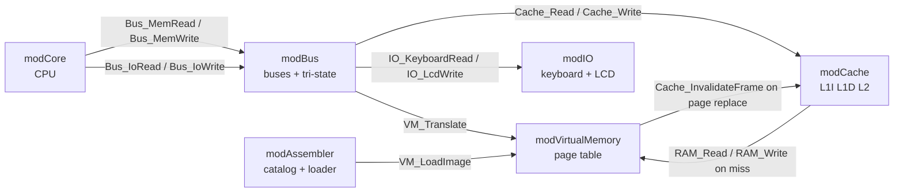

# Module Interfaces (contract)

This file is the **contract** between modules. Each module may only call the
public functions listed here. Changing this file requires a PR approved by both.

Each function below will first be added as a **working stub** (a simple
version that already runs), so each member can test her module without
waiting for the other. Each owner then replaces her stubs with the real
implementation **without changing the signature**.

---

## Memory access path

All addresses used by the CPU are **virtual** (9 bits, `0..511`).

1. The CPU asks the bus: `Bus_MemRead(vaddr, isInstr)`.
2. The bus translates: `pa = VM_Translate(vaddr, isWrite)` (may raise a page fault inside VM).
3. The bus reads through the cache: `Cache_Read(pa, isInstr)`.
4. On a miss, the cache reads physical RAM: `RAM_Read(pa)`.

**Cache policy: write-through.** Every write goes to the cache **and** to RAM,
so RAM is always up to date and the VM never needs to flush the cache —
it only calls `Cache_InvalidateFrame(frame)` before replacing a frame.

---

## modCore — owner: Alicia

| Function | Description |
|---|---|
| `Core_Reset()` | Registers, flags and PC to 0 |
| `Core_SetupSheet()` | Builds sheet `CPU` (registers, buttons, log) |
| `Core_Paint()` | Repaints sheet `CPU` |
| `BtnStep`, `BtnStepInstr`, `BtnRun`, `BtnPause`, `BtnReset` | Buttons |

After every micro-step, `modCore` calls `Bus_Paint`, `Cache_Paint`, `VM_Paint`, `IO_Paint`.

## modBus — owner: Alicia

| Function | Description |
|---|---|
| `Bus_Reset()` | All buffers to High-Z |
| `Bus_ControlWord(signals As String)` | Sets the active control word, e.g. `"En_PC Ld_MAR"` |
| `Bus_MemRead(vaddr As Long, isInstr As Boolean) As Long` | CPU memory read |
| `Bus_MemWrite(vaddr As Long, value As Long)` | CPU memory write |
| `Bus_IoRead(port As Long) As Long` | `IN` — enables `En_KBD` |
| `Bus_IoWrite(port As Long, value As Long)` | `OUT` — enables `Ld_LCD` |
| `Bus_Paint()` | Repaints the bus panel on sheet `CPU` |

## modCache — owner: Alicia

| Function | Description |
|---|---|
| `Cache_Reset()` | Empties L1I, L1D, L2 and counters |
| `Cache_Read(pa As Long, isInstr As Boolean) As Long` | Read through L1 → L2 → RAM |
| `Cache_Write(pa As Long, value As Long)` | Write-through |
| `Cache_InvalidateFrame(frame As Long)` | Drops cached lines of a physical frame |
| `Cache_SetupSheet()` / `Cache_Paint()` | Sheet `Cache` |

## modVirtualMemory — owner: Paola

| Function | Description |
|---|---|
| `VM_Reset()` | Empty page table, RAM and swap |
| `VM_Translate(vaddr As Long, isWrite As Boolean) As Long` | Virtual → physical; handles page fault |
| `VM_LoadImage(bytes() As Long, length As Long)` | Writes a program image into virtual space (swap) |
| `RAM_Read(pa As Long) As Long` | Physical RAM read (0..255) |
| `RAM_Write(pa As Long, value As Long)` | Physical RAM write |
| `VM_SetupSheet()` / `VM_Paint()` | Sheet `Memory` |

## modIO — owner: Paola

| Function | Description |
|---|---|
| `IO_Reset()` | Empties keyboard queue and LCD |
| `IO_KeyboardRead() As Long` | Pops one char from the keyboard queue (0 if empty) |
| `IO_LcdWrite(value As Long)` | Writes one char to the LCD video buffer |
| `IO_SetupSheet()` / `IO_Paint()` | Sheet `IO` |
| `BtnKeyboardSend` | Button: pushes typed text into the queue |

## modAssembler — owner: Paola

| Function | Description |
|---|---|
| `Asm_SetupSheet()` | Sheet `Programs` (catalog + editor) |
| `BtnAssemble` | Checks syntax, shows errors |
| `BtnLoadProgram` | Assembles and calls `VM_Reset`, `VM_LoadImage`, `Cache_Reset`, `IO_Reset`, `Bus_Reset`, `Core_Reset` |

---

## Sheets (each module paints only its own)

| Sheet | Owner module |
|---|---|
| `CPU` | modCore + modBus (Alicia) |
| `Cache` | modCache (Alicia) |
| `Memory` | modVirtualMemory (Paola) |
| `IO` | modIO (Paola) |
| `Programs` | modAssembler (Paola) |
| `Log` | modCore (Alicia) |
