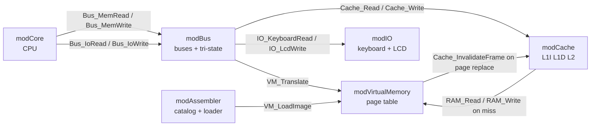

# Module Interfaces (contract)

This file is the **contract** between modules. Each module may only call the
public functions listed here. Changing this file requires a PR approved by both.

Each function below was first added as a **working stub** (a simple version
that already runs), so each member can test her module without waiting for
the other. Each owner then replaces her stubs with the real implementation
**without changing the signature**.

Public **variables** listed here may be **read** by other modules (for
example, to display them), but only the owner module may change them.

---

## Memory access path

All addresses used by the CPU are **virtual** (9 bits, `0..511`).

1. The CPU asks the bus: `Bus_MemRead(vaddr, isInstr)`.
2. The bus translates: `pa = VM_Translate(vaddr, isWrite)` (may raise a page fault inside VM).
3. The bus reads through the cache: `Cache_Read(pa, isInstr)`.
4. On a miss, the cache reads physical RAM: `RAM_Read(pa)`.

**Non-cacheable I/O range:** physical `E0h–EFh` (virtual `1E0h–1EFh`, keyboard
queue and LCD buffer) is always read and written directly in RAM, never cached.

**Cache policy: write-through.** Every write goes to the cache **and** to RAM,
so RAM is always up to date and the VM never needs to flush the cache —
it only calls `Cache_InvalidateFrame(frame)` before replacing a frame.

---

## modCore — owner: Alicia

`IN` and `OUT` do not modify the flags. `[BX]` uses effective address `100h + BX`.

| Function | Description |
|---|---|
| `Core_Reset()` | Registers, flags and PC to 0 |
| `Core_SetupSheet()` | Builds sheet `CPU` (registers, buttons, log) and calls `Bus_SetupSheet` |
| `Core_Paint()` | Repaints sheet `CPU` |
| `Core_Mnemonic(op As Long) As String` | Disassembles one opcode, e.g. `&H21` → `"ADD AX, BX"` (`"data"` if invalid) |
| `Core_InstrSize(op As Long) As Long` | Size in bytes (1, 2 or 3) of the instruction that starts with this opcode |
| `Core_TMP() As Long` | Value of the control unit's temporary register (for the bus panel) |
| `BtnStep`, `BtnStepInstr`, `BtnRun`, `BtnPause`, `BtnReset` | Buttons |
| `BtnLoadDemo` | Developer shortcut (hardcoded demo). **Removed in release v2.0** — programs live in sheet `Programs` |

**Public variables (read-only for other modules):** `PC`, `IR`, `MAR`, `MDR`,
`AX`, `BX`, `CX`, `DX`, `ZF`, `CF`, `SF`, `OPV` (operand, `-1` = none), `Halted`.

After every micro-step, `modCore` calls `Bus_Paint`, `Cache_Paint`, `VM_Paint`, `IO_Paint`.

## modBus — owner: Alicia

| Function | Description |
|---|---|
| `Bus_Reset()` | All buffers to High-Z |
| `Bus_ControlWord(signals As String)` | Sets the active control word, e.g. `"En_PC Ld_MAR"` |
| `Bus_MemRead(vaddr As Long, isInstr As Boolean) As Long` | CPU memory read |
| `Bus_MemWrite(vaddr As Long, value As Long)` | CPU memory write |
| `Bus_IoRead(port As Long) As Long` | `IN` — enables `En_KBD` |
| `Bus_IoWrite(port As Long, value As Long)` | `OUT` — enables `Ld_LCD` |
| `Bus_SetupSheet()` | Creates the bus table and the bus diagram on sheet `CPU` |
| `Bus_Paint()` | Repaints the bus panel on sheet `CPU` |
| `Bus_ControlBits() As String` | The 24-bit control word as text, e.g. `"10010000 00000000 00000000"` |

**Public variables (read-only):** `ControlWord`, `AddressBus` (9 bits),
`DataBus` (8 bits, `-1` = High-Z).

## modCache — owner: Alicia

| Function | Description |
|---|---|
| `Cache_Reset()` | Empties L1I, L1D, L2 and counters |
| `Cache_Read(pa As Long, isInstr As Boolean) As Long` | Read through L1 → L2 → RAM |
| `Cache_Write(pa As Long, value As Long)` | Write-through |
| `Cache_InvalidateFrame(frame As Long)` | Drops cached lines of a physical frame |
| `Cache_LastResult() As String` | Text of the last access, e.g. `"L1I HIT 01h"` (shown in the bus diagram) |
| `Cache_SetupSheet()` / `Cache_Paint()` | Sheet `Cache` |

**Public variables (read-only):** `L1I_Hits`, `L1I_Misses`, `L1D_Hits`,
`L1D_Misses`, `L2_Hits`, `L2_Misses`, `Uncached`.

## modVirtualMemory — owner: Paola

| Function | Description |
|---|---|
| `VM_Reset()` | Empty page table, RAM and swap |
| `VM_Translate(vaddr As Long, isWrite As Boolean) As Long` | Virtual → physical; handles page fault. Page 15 is pinned to frame 7 and never replaced by FIFO (FIFO uses frames 0–6) |
| `VM_LoadImage(bytes() As Long, length As Long)` | Writes a program image into virtual space (swap) |
| `RAM_Read(pa As Long) As Long` | Physical RAM read (0..255) |
| `RAM_Write(pa As Long, value As Long)` | Physical RAM write |
| `VM_SetupSheet()` / `VM_Paint()` | Sheet `Memory` |

**Public variables (read-only):** `VM_Accesses`, `VM_PageFaults`.

## modIO — owner: Paola

| Function | Description |
|---|---|
| `IO_Reset()` | Empties keyboard queue and LCD |
| `IO_KeyboardRead() As Long` | Pops one char from the keyboard queue stored in RAM `E0h–E7h` (0 if empty) |
| `IO_LcdWrite(value As Long)` | Writes one char to the LCD video buffer stored in RAM `E8h–EFh` |
| `IO_SetupSheet()` / `IO_Paint()` | Sheet `IO` |
| `BtnKeyboardSend` | Button: pushes typed text into the queue in RAM (max 8 chars) |

The queue and LCD **contents live in RAM** (through `RAM_Read` / `RAM_Write`);
only helper counters (queue length, LCD cursor) may be VBA variables.

## modAssembler — owner: Paola

| Function | Description |
|---|---|
| `Asm_SetupSheet()` | Sheet `Programs` (catalog + editor) |
| `BtnAssemble` | Checks syntax, shows errors |
| `BtnLoadProgram` | Assembles and calls `VM_Reset`, `VM_LoadImage`, `Cache_Reset`, `IO_Reset`, `Bus_Reset`, `Core_Reset` |

---

## Sheets (each module paints only its own)

| Sheet | Owner module |
|---|---|
| `CPU` | modCore (registers, control unit, log) + modBus (bus table in `F:N`, bus diagram from column `P`) — Alicia |
| `Cache` | modCache (Alicia) |
| `Memory` | modVirtualMemory (Paola) |
| `IO` | modIO (Paola) |
| `Programs` | modAssembler (Paola) |
| `Log` | modCore (Alicia) |
